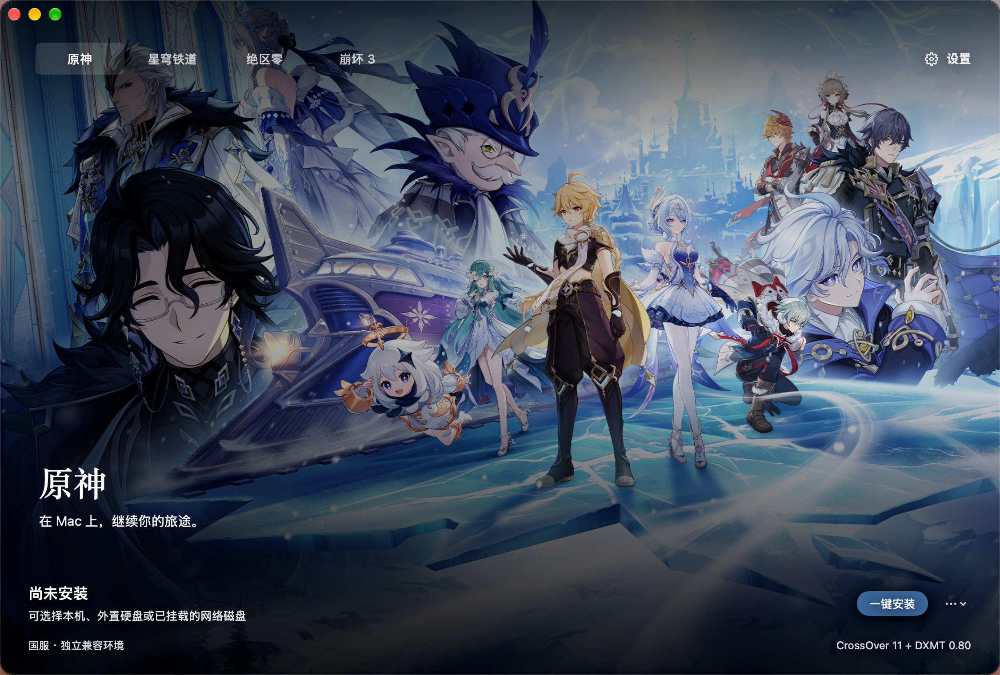

# 星桥 HoYoBridge

**让米哈游游戏在 Mac 上，拥有一个熟悉的入口。**

星桥是面向 Apple Silicon Mac 的非官方游戏启动器，围绕原神、崩坏：星穹铁道、绝区零和崩坏 3，提供独立安装、游戏管理和兼容环境准备。

选择想玩的游戏，确认安装位置，再从同一个界面启动。不必为了玩一款游戏，把另外三款也装进电脑。

[下载最新版本](https://github.com/huaye37/HoYoBridge/releases/latest) · [版本更新日志](https://github.com/huaye37/HoYoBridge/releases)



> **尚未完成 Apple 公证**
>
> 首次打开时，macOS 可能提示“无法验证开发者”或“Apple 无法检查是否包含恶意软件”。确认从本项目下载后，请前往「系统设置 → 隐私与安全性」，点击「仍要打开」，按提示确认即可。由此带来的不便，敬请谅解。
>
> **管理国服与国际服官服，不支持 B 服等渠道服。国际服的官方下载信息已验证，完整安装、启动与登录仍待逐款实测；崩坏 3 此轮国际版为欧美客户端。**

## 特点

- **按游戏独立安装：** 四款游戏分别管理目录与任务，不捆绑下载。
- **以游戏为主的界面：** 独立封面、明确的主操作按钮、任务进度和错误说明。
- **减少环境配置：** 启动器按需下载并准备固定兼容组件，不要求玩家安装 Docker、Python 或 Steam 客户端。
- **安装位置可控：** 提供本地推荐路径，也可选择其他目录或外置硬盘。
- **实验功能自选：** 120 FPS 目标与 Metal HUD 默认关闭。
- **启动器内更新：** 在「设置 → 应用更新」检查新版本、阅读中文更新日志，由你确认下载安装。可在游戏运行或下载暂停时检查、下载启动器更新；安装阶段等待游戏退出和下载暂停，保留游戏文件与续传记录。
- **国服／国际服分开管理：** 同一游戏的不同客户端分别保存目录、任务和运行环境，可同时安装。
- **下载与游玩互不占用入口：** 下载其他客户端时，可启动已经安装好的游戏；正在安装、更新或修复的客户端不能同时启动。
- **占用与清理：** 显示当前客户端的游戏／已下载文件大小；下错且未完成的首次下载可取消并清理。

星桥与米哈游、HoYoverse、Apple 或 CodeWeavers 无官方隶属或合作关系。

## 游戏支持情况

“曾经进入游戏”与“当前安装、更新、恢复流程全部验收”是不同状态。

| 游戏（国服） | 安装方式 | 当前验证范围 |
| --- | --- | --- |
| 原神 | 后台官方引擎适配器 | 用户已确认国服 7.2.0 可正常游玩；全新安装与后续版本更新仍分别验收 |
| 崩坏：星穹铁道 | 后台官方引擎适配器 | 用户已确认国服 4.7.0 可正常游玩，并有 PS5 蓝牙手柄反馈；全新安装与后续版本更新仍分别验收 |
| 绝区零 | 后台官方引擎适配器 | 已有用户测试反馈；新适配器的完整安装与更新链路仍待单独验收 |
| 崩坏 3 | 后台官方引擎适配器 | 新适配器已完成完整下载、独立文件校验及暂停／重启续传测试；后续版本维护仍需验证 |

四款游戏统一接入后台官方引擎，提供检查更新、更新、校验修复、目录关联与卸载入口。崩坏 3 已通过真实卸载测试，其他游戏尚未逐款卸载验收。窗口、手柄和性能表现不能在四款游戏间相互推定。

上述可游玩版本由用户于 2026 年 11 月 15 日确认；本轮环境为 Apple M5 Pro、macOS 27.3、CrossOver Wine 11.0-1 + DXMT 0.80。国际服已接入官方下载信息与独立管理，尚不列为已验证可玩；崩坏 3 国际服目前指欧美客户端。

每款游戏标题旁可选择「国服／国际服」，分别保存目录、下载进度、更新状态和运行环境。已有国服路径保持原位，新国际服默认使用带 `Global` 后缀的独立目录；不能把两套客户端关联到同一个或相互包含的目录。全屏／窗口与启动分辨率仍为启动器共用设置，游戏内画质、语言和登录状态由各客户端独立保存。

主页显示当前客户端的游戏占用，首次下载未完成时显示已下载文件占用；下载中数值为扫描时快照，可从菜单重新统计。未完成的首次下载可在「… → 取消下载并清理文件」中确认清理，更新／修复任务不会进入这个入口。官方服务删除的下载文件无法恢复，遗留文件可移入废纸篓时会保留恢复机会；清空废纸篓后才能释放对应空间。

## 系统要求

- **芯片：** Apple Silicon，当前不面向 Intel Mac。
- **系统：** 应用要求 macOS 26 或更新版本，项目适配范围为 macOS 26/27；测试版系统可能出现额外兼容问题。
- **Rosetta：** 兼容环境运行所需；应用会检查，缺失时提供安装指引。
- **空间：** 按所选游戏资源大小预检，另外需要运行环境、下载缓存和更新临时空间，不能只预留游戏最终占用。
- **网络：** 首次安装和更新需要访问官方资源服务。

当前固定组合为 **CrossOver Wine 11.0-1 + DXMT 0.80 + Steam 兼容组件**。兼容组件不是 Steam 客户端，不要求 Steam 账号。目前不支持任意替换 Wine；GPTK 不在产品提供的运行路线中。

## 安装与使用

### 获取应用

前往 [最新 Release](https://github.com/huaye37/HoYoBridge/releases/latest)，在页面底部 **Assets** 下载 `HoYoBridge-macOS-arm64.zip`，解压后将 `HoYoBridge.app` 拖入「应用程序」。普通用户无需克隆源码或自行编译。

每个新版本都直接发布到 **GitHub Releases**，提供安装包、SHA-256 校验文件和中文版本日志，不再标记 Pre-release。发布日志列出新增功能、改进与修复、升级方式及已知问题；历史版本保留在 [全部 Releases](https://github.com/huaye37/HoYoBridge/releases)。Release 分类不改变签名状态：当前应用仍未完成 Apple 公证。

附件文件名如下（`Source code` 是源码，不是应用安装包）：

```text
HoYoBridge-macOS-arm64.zip
HoYoBridge-macOS-arm64.zip.sha256
```

取得可信发行包后，在两个文件所在目录检查下载完整性：

```bash
shasum -a 256 -c HoYoBridge-macOS-arm64.zip.sha256
```

当前应用使用 ad-hoc 完整性签名，尚未完成 Apple 公证。首次打开被系统拦截时，确认来源与文件完整性后，按「系统设置 → 隐私与安全性」提示打开；无需全局关闭系统安全功能。

### 更新启动器

打开「设置 → 应用更新 → 检查更新」，阅读中文日志后确认安装。更新只替换启动器，不重新安装游戏，也不迁移游戏目录或账号环境。自动检查可自行开启，安装仍由你确认。

0.1.12 起，游戏运行时也能检查和下载启动器更新；安装时等待游戏退出及下载暂停，已暂停任务会保留文件和续传记录。仅 v0.1.0 等尚未内置更新源的早期版本需要手动安装一次新版，之后即可在启动器内更新。

### 安装游戏

1. 打开星桥，选择想玩的游戏。
2. 点击安装，确认推荐位置或选择其他磁盘。
3. 等待资源下载、校验和兼容环境准备完成。
4. 点击启动，在游戏内使用自己的账号登录。

四款游戏均提供“使用推荐位置”和“更改位置”选项。下载由后台官方引擎执行，不提供 YAAGL 下载入口或失败回退，应用包不再附带旧 YAAGL/Python 下载器。官方引擎窗口和 Dock 入口由后台模式隐藏；干净机器的完整无感流程仍在验证。

### 推荐安装目录

`~` 表示当前用户的个人文件夹，例如 `/Users/你的用户名`。

```text
~/Games/HoYoBridge/
├── Genshin Impact/
├── StarRail/
├── ZenlessZoneZero/
└── HonkaiImpact3/
```

只下载玩家选择的游戏。兼容环境和应用设置另存于本机应用支持目录。

- 已有安装路径不变，不因项目改名自动搬动文件。
- 外置硬盘需在安装、更新和运行期间保持连接。
- NAS 暂不推荐作为默认位置；直接运行、更新和断连恢复需要分别验收。
- 通用迁移和缓存清理尚未完成。卸载位于游戏管理菜单，会确认实际目录并永久移除游戏安装内容，无法从废纸篓恢复；请先备份目录中的个人文件。兼容环境与其他游戏保留。

## 窗口、分辨率与运行环境

启动器的窗口模式与启动分辨率应用于四款游戏；画质、语言等游戏内设置由各游戏独立管理。实际显示效果取决于游戏及兼容配置。

0.1.12 增加显示器模式、16:10／超宽屏／MacBook 常用尺寸与自定义分辨率。启动先进入可缩放的普通窗口，左上角绿钮负责 macOS 全屏；星铁独立的已保存全屏记录也会按启动器显示设置处理。游戏内部的分辨率菜单仍由游戏自身枚举。

0.1.13 增加「游戏显示器」：内建屏幕与外接显示器分别列出，竖屏标注为不用于游戏，所选屏幕断开时临时回退到其他横屏。分辨率列表按目标屏幕整理，窗口首次居中到该屏；后续拖动与缩放不被重复覆盖。HiDPI 的「当前渲染像素」不等于面板物理分辨率。以上设置在下次启动生效，并非游戏内实时分辨率控制；各游戏自己的可选菜单仍可能不同。

绝区零国际服已发现偶发保护模块 `MHYPBase.dll` 初始化崩溃，正在调查；窗口改进不代表已修复该闪退，三款游戏的双横屏实际游玩验证仍待完成。

运行环境页列出玩家已确认可正常游玩的原神国服 7.2.0、星穹铁道国服 4.7.0（2026-11-15），不将安装成功视作可玩确认。星铁国服的专用辅助程序改为首次安装或自身升级时授权，后续复用；用途和回滚说明见 [启动辅助程序](docs/STARTUP_HELPER.md)。

新窗口行为和首次系统级辅助程序安装仍待新版实际游玩验收；自动化测试通过不代表所有游戏、显示器和系统组合均已实测。

实验功能需要手动开启：

- **120 FPS 目标：** 默认关闭；为四款游戏设置 DXMT 渲染上限，原神额外尝试解锁。其他游戏仍受自身帧率限制，120 是目标而非保证。
- **Metal HUD：** 显示图形运行指标，不会自动提高性能。

游戏更新可能改变资源格式和启动条件，不能保证每次更新后无需适配即可启动。出现异常应保留现有目录和日志，不建议首先删除游戏。

## 已知限制

尚待完成的验证与能力：

- 四款游戏经过真实版本更新验收的统一预下载流程。
- 启动器已开放签名更新源；真实 0.1.4 临时副本的公开包下载、验签、替换和探针重启验证通过，正式设置窗口中的用户升级验收单独记录。
- 所有运行组件与美术素材的公开分发许可核对。
- Developer ID 签名、公证和干净 Mac 完整安装验收。

## 问题反馈

客户端一键反馈、自动上传诊断和自动修复系统暂缓开发，目前没有接入玩家反馈服务，也不会自动将日志发送给维护者。

先查看应用的错误说明和日志入口。反馈请附上：

- Mac 芯片、内存、macOS 版本及是否为测试版系统。
- 星桥版本、游戏名称与版本、兼容组件版本。
- 问题阶段：下载、校验、环境准备、启动、登录或游戏内。
- 复现步骤、错误截图和脱敏后的相关日志片段。

**不要上传密码、验证码、登录令牌、完整账号环境或未经检查的整个日志目录。** 请通过 [Issues](https://github.com/huaye37/HoYoBridge/issues) 反馈。

## 开发与构建

项目使用 SwiftPM，要求 Swift 6.2 工具链及相应 Xcode。应用运行要求与核心包的最低编译平台声明不同。

获取源码并验证：

```bash
git clone https://github.com/huaye37/HoYoBridge.git
cd HoYoBridge
env -u PROTOC_PATH swift build
env -u PROTOC_PATH swift test
```

`SwiftProtobufPlugin` 是固定代码生成入口，请保留 `env -u PROTOC_PATH`，不要替换为未固定的系统 `protoc`。[CI 参考配置](.github/ci-reference.yml) 暂未启用：当前发布凭证没有工作流写入权限。该配置仅构建与测试，不执行发行打包，也不证明游戏可玩。

准备好打包脚本要求的固定 `LocalRuntimes` 资产后：

```bash
# 开发构建并打开应用
bash script/build_and_run.sh

# 本地优化构建，生成测试 ZIP 和 SHA-256（不是 GitHub Release，不上传）
MGB_BUILD_CONFIGURATION=release bash script/build_and_run.sh --package

# 检查 ZIP 内应用的标识、架构、签名和下载完整性
bash script/verify_release.sh --local

# 正式分发前额外检查 Gatekeeper 与公证票据
bash script/verify_release.sh --public
```

产物为 `dist/HoYoBridge.app` 和 `dist/HoYoBridge-macOS-arm64.zip`。`--public` 不会自动签名或公证，当前 ad-hoc 包不满足正式分发验收。

命令中的 `release` 只是编译优化配置，不代表已上传。当前 GitHub CI 尚未启用，本机执行构建和测试。每个交付版本都发布为普通 GitHub Release，附安装包、SHA-256 和中文日志，并同步经过签名的启动器更新目录；未公证状态与实测范围如实写明。具体步骤见 [自更新发布说明](docs/LAUNCHER_SELF_UPDATE.md)。

功能变更时同步更新本 README 的功能、使用方式和限制；每版细节另外记录在 `docs/releases/v版本号.md`，用于 Release 正文和启动器更新弹窗。

**仅克隆源码不能重现完整发行包：** `LocalRuntimes` 不入库，组件获取来源和可再分发范围仍需完善。打包脚本会关闭正在运行的星桥启动器，不会借此结束游戏进程。

对外名称为「星桥 HoYoBridge」。为兼容已有安装，Swift 包名、可执行文件、内部标识和历史数据目录仍保留 `MacGameBridge`，请勿全局替换。

## 文档与贡献

提交改动前请阅读 [项目规则](AGENTS.md)，说明影响的游戏、复现步骤及验证范围，不提交本机游戏文件、账号环境或日志。

- [当前工作上下文](docs/CURRENT_WORKING_CONTEXT.md)：最近实现和验证记录。
- [首次发行验收](docs/FIRST_RELEASE_GAPS.md)：发行前缺口与证据。
- [架构说明](docs/ARCHITECTURE.md)：模块与技术方向。
- [下载边界](docs/NETWORK_DOWNLOADS.md)、[安全解压](docs/SAFE_EXTRACTION.md)、[运行时存储](docs/RUNTIME_STORE.md)：底层实现。
- [历史开发说明](docs/README_DEVELOPMENT_HISTORY.md)：旧 README 技术记录，不作为当前兼容性承诺。

## 技术结构

- `Sources/BridgeStatus`：macOS 界面、四游戏状态、安装维护适配、兼容启动和启动器自更新。
- `Sources/BridgeCore`：资源清单、校验、存储、命令执行及底层能力；保留的清单研究代码不等于当前产品仍使用旧下载器。
- `script`：本机打包、验证及实验辅助脚本；部分脚本依赖未入库的固定本地资产。
- `Tests`：自动化测试；测试通过与游戏真实登录、游玩、版本更新验收分别记录。
- `LICENSES`、`THIRD_PARTY_NOTICES.md`：第三方许可原文及用途、来源说明。

## 借鉴项目与第三方组件

本项目不是下列项目的官方发行版。区分直接依赖、代码／资源复用和历史参考，不将第三方成果声明为本项目原创。

| 项目或来源 | 本项目中的用途 | 许可与说明 |
| --- | --- | --- |
| [YAAGL](https://github.com/yaagl/yet-another-anime-game-launcher) | 兼容启动参考、清单 schema、固定 sidecar 中的兼容资产 | 固定提交 `ca78abc29c2fc236261d088c6907d28cab6e9476`；YAAGL 自有代码为 MIT，sidecar 各组件须独立核对；已退出游戏下载主流程 |
| [anime-game-wine](https://github.com/yaagl/anime-game-wine)、[Wine](https://gitlab.winehq.org/wine/wine) / CodeWeavers | Wine 兼容环境来源与基础 | 固定 Wine CrossOver 11.0-1；不能将 Wine 源码许可等同于整个预编译包或商业 CrossOver 产品的授权 |
| [DXMT](https://github.com/3Shain/dxmt) | 图形转换，固定 0.80 | 完整预编译组件及其依赖的分发清单仍待核对 |
| [Jadeite](https://github.com/mkrsym1/jadeite) | 特定游戏启动兼容配置 | 4.1.0，MIT；不保证后续游戏版本兼容 |
| [genshin-fps-unlock](https://github.com/34736384/genshin-fps-unlock) | 原神帧率目标定位思路及衍生实现 | 参考 `netcore` 分支，MIT；不捆绑上游启动程序 |
| [Sparkle](https://github.com/sparkle-project/Sparkle) | 启动器自更新 | 2.9.6，MIT |
| [SwiftProtobuf](https://github.com/apple/swift-protobuf) | Protocol Buffers 编解码和固定代码生成 | 1.38.1，Apache-2.0 及其运行时例外；构建依赖另有许可 |
| [Zstandard](https://github.com/facebook/zstd) | 底层解压能力 | 1.5.7，采用仓库 BSD 许可文本 |
| [7-Zip](https://www.7-zip.org/) | 官方安装器解包 | 7zz 21.07，LGPL / unRAR 限制 / BSD，保留完整原文 |
| [Snap.Hutao 相关讨论](https://github.com/DGP-Studio/Snap.Hutao/issues/2446) / Lightczx | YAAGL 差分清单文件中记录的更早来源 | 间接来源，不是本项目对 Snap.Hutao 整体代码的直接依赖；原始归属注释保留，具体贡献授权仍需核对 |

具体版本、复用位置、许可原文和待核对项见 [第三方声明](THIRD_PARTY_NOTICES.md)。本表不代表所有二进制分发义务已完成。

## 非官方声明、版权与许可

项目自有代码采用 [MIT License](LICENSE)。第三方代码与运行组件遵循各自许可证，详见 [第三方声明](THIRD_PARTY_NOTICES.md)和 [许可文本](LICENSES)。MIT 不授予游戏资源、角色形象、商标或第三方二进制的额外使用权。

1. **独立、非官方项目。** 本项目与米哈游、HoYoverse、Apple、CodeWeavers 及上述开源项目不存在官方隶属、认可、赞助或合作关系；名称仅用于识别支持对象和技术来源。
2. **游戏权利不转移。** 游戏名称、角色、商标、客户端、图片、音频和其他资源归各自权利人所有。本项目的 MIT 许可证不覆盖这些内容，不提供游戏授权、账号或付费内容。
3. **美术素材单独处理。** 动态封面来自官方展示接口；仓库还含官方回退图片和以游戏角色为参考生成的图标。公开可下载、经过 AI 生成或附上致谢均不等于取得再分发授权。来源见 [背景记录](docs/LAUNCHER_ARTWORK.md) 和 [图标记录](docs/APP_ICON.md)；授权未确认的素材在公开分发前必须取得适用授权、替换或移除。
4. **官方服务并非官方集成授权。** 下载由后台官方引擎执行，使用未公开承诺稳定的本地接口；安装器按需从官方 CDN 获取，不捆绑游戏整包。这不意味着米哈游为本项目提供技术支持或批准该集成。
5. **兼容性和账号后果。** 项目按现状提供，不保证所有版本可用、性能达到特定水平或账号不会受限制。用户仍需遵守相应游戏服务条款；本项目不修改服务器数据、不篡改联机结果、不提供角色能力提升。
6. **尊重上游许可。** 复制或修改的第三方代码保留归属及许可，依赖按各自许可证处理。尤其不能以 YAAGL 的 MIT 许可替代 Wine、Steam 兼容资产和其他附带组件的各自义务。

权利人如发现归属、素材使用或许可记录有误，可通过 [Issues](https://github.com/huaye37/HoYoBridge/issues) 联系维护者并提供具体文件、权利依据和诉求；维护者核实后更正、替换或移除。**免责声明不能替代授权，也不能消除应承担的责任。**
